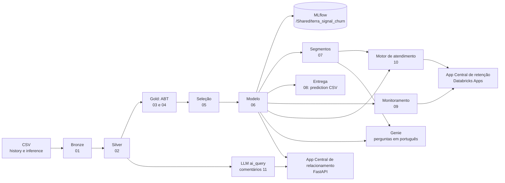

# Terra Signal: previsão e prevenção de churn

**Hackathon Databricks Academia · ASN.Rocks · Grupo 4**

**Equipe:** André Ferreira, Antonio Menezes, Júlia Vale e Lucas Menghi

A Terra Signal perde 26,7% dos clientes (30,8% da receita mensal) sem saber quem vai sair. Este projeto vai do CSV bruto
até a ligação de retenção: um modelo que ordena a carteira pelo risco, segmentos que dizem que oferta fazer, um app que
leva o modelo para a central de atendimento e um monitoramento que avisa quando o modelo envelhece.

## Resultados

| O que | Número |
|---|---|
| Modelo | Regressão logística regularizada, 41 variáveis, escolhida entre seis pela consistência treino/teste/total. Ridge e Lasso empataram (ver "Ridge ou Lasso") |
| Qualidade em clientes que o modelo não viu | ROC-AUC 0,830 · recall 78% · precisão 52% · F1 0,624 · KS 0,523 |
| Ganho para a retenção | Os 20% de maior risco concentram 48% de quem sai (2,4 vezes o sorteio); o decil 1 tem 76% de churn |
| Carteira pontuada | 571 de 1.409 clientes com sinal de saída (40,5%); 398 para "salvar já" |
| Onde agir | Segmento S1 (fibra, contrato mensal, pouca proteção): 30% da carteira, 41% da receita, 62% de quem saiu |
| Referência externa | A base tem o tamanho e as colunas da IBM Telco Customer Churn. Um trabalho público com a mesma base chega a ROC-AUC 0,830 com logística e 0,836 com *gradient boosting*, mas, sem balancear as classes, a logística dele encontra 5 em cada 10 clientes que saem (recall 52%); a nossa encontra 8 em cada 10, com o mesmo ROC-AUC |

O comentário do cliente (`CustomerFeedback`) ficou fora do modelo: com ele, a AUC sobe para 0,993, porque o texto foi
escrito por quem já decidiu sair (vazamento; decisão D9). Ele é lido por um modelo de linguagem (notebook 11) para
orientar a conversa da central, não para dar a nota.

## Ridge ou Lasso

Na comparação dos seis modelos, as duas regressões logísticas regularizadas empataram: na execução original do Antonio
a regra de consistência escolheu a **Ridge** (C = 0,03, limiar 0,4944, ROC-AUC 0,845 no teste); na execução com a
separação treino/teste fixa (treino ordenado por cliente), escolheu a **Lasso** (C = 0,3, limiar 0,5046, ROC-AUC
0,830), por 0,003 no placar.

- **A apresentação e o app Central de relacionamento usam a Ridge**, pela leitura de negócio: ela não descarta
  nenhuma variável (a Lasso zera 11) e divide o peso entre variáveis que andam juntas, como mensalidade e fibra.
- **O pipeline dos notebooks 06 a 10 e o app Central de retenção usam a Lasso**, a registrada no MLflow.
- **Na mesma separação, as duas dão a mesma fila:** correlação de 0,999 entre as notas, 222 dos 225 clientes do topo
  em comum e 99 de cada 100 com o mesmo Sim/Não. Detalhes no `DOC_MODELO.md`.

## Arquitetura



Tudo fica no Unity Catalog, em `workspace.terra_signal`, na arquitetura medalhão (bronze, silver, gold).

## Estrutura do repositório

```
README.md · DOC_MODELO.md · DECISOES.md · prediction_grupo4_<data_hora>.csv
history.csv · inference.csv   os arquivos do hackathon (o _comum também os encontra numa pasta dados/)
NOTEBOOK.ipynb · SETUP.md     o notebook inicial e o guia dos organizadores
notebooks/                    _comum, 00 a 11 e instalar_app
app_monitoramento/            app Central de retenção (Streamlit)
app_central_relacionamento/   app Central de relacionamento (FastAPI)
```

## Notebooks

Rodar em ordem, de cima para baixo. O `_comum` é chamado por todos (`%run ./_comum`).

| Notebook | O que faz | Grava |
|---|---|---|
| `00_documentacao` | O projeto nos 7 passos, decisões, métricas e deploy | — |
| `01_dicionario_dados` | Lê os CSV, confere a qualidade, monta o dicionário | `bronze_history`, `bronze_inference` |
| `02_preparacao_dados` | Aplica as decisões de limpeza (D1 a D8) | `silver_history`, `silver_inference` |
| `03_analise_exploratoria` | Quem sai e por quê; vazamento do texto; PSI entre as bases | `dicionario_dados`, `dicionario_categorias` |
| `04_variaveis_e_abt` | Variáveis derivadas e a ABT | `gold_churn_treino`, `gold_churn_inferencia`, `gold_churn_dicionario`, `gold_churn_texto` |
| `05_selecao_variaveis` | Separação treino/teste e as 41 colunas, conferidas com os métodos da aula | `gold_churn_split`, `gold_churn_variaveis_modelo`, `gold_churn_selecao` |
| `06_modelagem` | Seis modelos, limiar, avaliação, KS e lift, pipeline no MLflow | `gold_churn_abt_scored`, `gold_churn_inferencia_scored`, `gold_churn_modelo_info` |
| `07_segmentacao` | K-means no comportamento, risco × valor, oferta por segmento | `gold_churn_segmentos`, `gold_churn_segmentos_perfil` |
| `08_entrega` | Arquivo de previsão e conferência em 8 regras | `prediction_grupo4_<data_hora>.csv` |
| `09_monitoramento` | PSI, taxa de Yes, reprodução pelo MLflow, semáforo e lote simulado | `gold_churn_monitoramento`, `gold_churn_monitoramento_distribuicao`, `gold_churn_fila_retencao` |
| `10_atendimento` | Exporta o modelo para o app e confere; motivos, ofertas, preço, curva de ganho; relato de cada cliente (abordagem e receptividade) | `gold_churn_ofertas` e os arquivos do app |
| `11_feedback_llm_ai_query` | Lê o comentário de cada cliente com LLM (`ai_query`, `system.ai.gpt-oss-20b`): situação relatada, sentimento e motivos, com validação técnica (5.432 válidos e 1.611 com alerta, em 7.043) | `feedback_clientes_v2` e o arquivo do app Central de relacionamento |

A documentação do modelo (seleção, modelos, limiar, avaliação e produção) está no `DOC_MODELO.md`, e as decisões D1 a
D25 no checklist do início de cada notebook (D26, a leitura do comentário por LLM, no notebook 11 e no `DECISOES.md`).

## Os dois apps

O grupo construiu duas interfaces sobre o mesmo modelo, ambas no Databricks Apps:

| App | Pasta | Tecnologia | O que faz |
|---|---|---|---|
| Central de relacionamento | `app_central_relacionamento` | Python + FastAPI | A carteira dos 1.409 clientes da inferência por risco; o perfil do cliente numa tela, com a nota (Ridge) e a leitura do comentário pela LLM; jornada de missões para a operadora. É o app da apresentação |
| Central de retenção | `app_monitoramento` | Streamlit | O modelo (Lasso) aplicado em oito páginas: atendimento receptivo e ativo com escada de ofertas e simulador, plano de marketing, campanha pelo lucro, fila, saúde do modelo, deriva, ficha do modelo e perguntas em português pelo Genie |

Cada pasta tem o seu README com o passo a passo de publicação.

### Central de retenção, página a página

| Página | Para quem | O que faz |
|---|---|---|
| Atendimento | Operadora | Receptivo (o cliente ligou) e ativo (a lista de ligações, separada em retenção, recuperação e fidelização e ordenada pela receptividade do último relato): risco, motivos, relato, histórico de contatos, escada de ofertas e simulador; pacote para quem ainda não é cliente; registro com roteiro da ligação, missões do dia, XP e conquistas |
| Plano de marketing | Marketing | O catálogo de ofertas (ativa, fala, validade, segmentos), que a escada do atendimento segue, e quantos clientes da fila o plano tira da zona de risco |
| Campanha de retenção | Gestor | Quantos clientes contatar para o maior lucro, com custo, aceite e desconto informados |
| Fila de retenção | Gestor | Matriz risco × valor e a fila, com segmento e oferta |
| Saúde do modelo | Time de dados | Semáforo do lote e as ações necessárias |
| Deriva das variáveis | Time de dados | O que mudou na carteira em relação ao treino |
| Ficha do modelo | Todos | Modelo, métricas, curva de ganho e regras de retreino |
| Pergunte aos dados | Gestores | Perguntas em português respondidas pelo Genie (espaço Terra Signal · Retenção) |

O app usa exatamente o modelo registrado: o notebook 10 confere que a nota calculada pelo app é igual à publicada
(diferença 0).

## Entrega

- **Arquivo de previsão:** `prediction_grupo4_<data_hora>.csv` na raiz, com `customerID` e `prediction` (Yes/No) para os
  1.409 clientes da inferência, na ordem do `inference.csv`.
- **Modelo:** MLflow, experimento `/Shared/terra_signal_churn`; o endereço do registro fica na tabela `gold_churn_modelo_info`.
