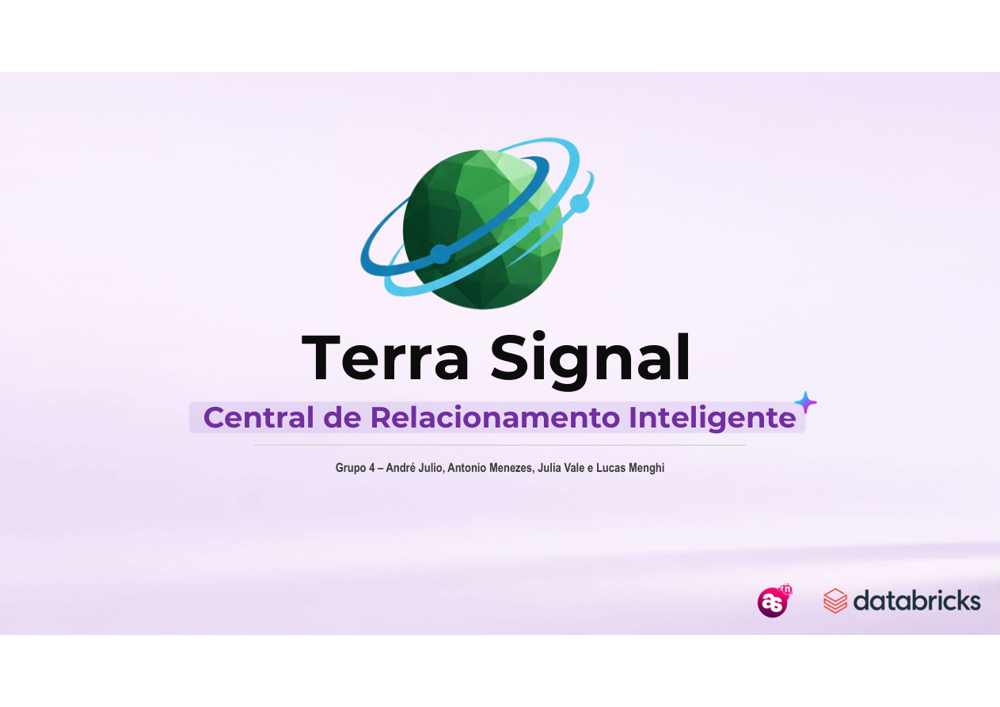
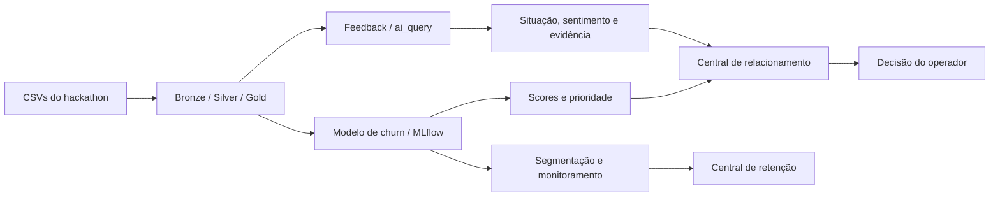

# Terra Signal

### Central de Relacionamento Inteligente

[](apresentacao/TerraSignal_Pitch_Final.pdf)

**Hackathon Databricks Academia · ASN.Rocks · Grupo 4**
**Equipe:** André Ferreira, Antonio Menezes, Júlia Vale e Lucas Menghi.

Uma fila com prioridade. Uma conversa com contexto. Uma central que reúne dados cadastrais, risco de churn e interpretação do relato do cliente para apoiar a decisão do operador.

**[Apresentação final (PDF)](apresentacao/TerraSignal_Pitch_Final.pdf)** · **[Guia técnico](docs/GUIA_TECNICO.md)** · **[Documentação do modelo](docs/DOC_MODELO.md)** · **[Decisões do grupo](docs/DECISOES.md)**

## O projeto

A solução combina um pipeline de dados no Databricks, um modelo de propensão e a leitura de comentários por LLM. A central apresenta o risco, os produtos contratados, o sentimento e as evidências do relato em um único perfil. Regras sugerem encaminhamentos; o operador decide a ação.

- **Dados:** 5.634 clientes no histórico e 1.409 na inferência; 1.504 registros históricos com churn (26,7%, sem horizonte temporal definido).
- **Modelo do pitch:** regressão logística Ridge (L2), 41 variáveis, seis candidatos e cinco folds de validação. Feedback e derivados ficam fora do modelo de churn.
- **Voz do cliente:** `ai_query` com `system.ai.gpt-oss-20b`, situação relatada, sentimento, motivos e evidência literal. São 7.043 comentários processados: 5.432 retornos tecnicamente válidos e 1.611 com alerta para revisão.
- **Aplicação:** carteira priorizada, filtros, perfil do cliente e missões guiadas para aprender a usar a central.

## Resultados da apresentação final

Avaliação retrospectiva da **Ridge**, execução do Antonio, com 4.507 clientes de treino e 1.127 de teste. Limiar 0,4944 escolhido por F1 nas previsões out-of-fold do treino.

| Indicador | Resultado |
|---|---:|
| ROC-AUC | 0,845 |
| Average Precision | 0,657 |
| F1 no limiar 0,4944 | 0,634 |
| Churns concentrados nos 20% de maior risco | 51,8% |
| Precisão entre os 226 contatos priorizados | 69,0% |
| Lift nessa fila | 2,58× |

Os 226 contatos concentram 156 dos 301 churns do teste. Concentrar churn no ranking não demonstra retenção incremental. Não há validação temporal ou impacto comercial medido; as premissas financeiras do pitch são ilustrativas.

**Duas execuções documentadas:** o pitch e a Central de relacionamento usam Ridge; o pipeline dos notebooks 06–10 e a Central de retenção usam Lasso (C = 0,3; ROC-AUC 0,830). Seus resultados pertencem a execuções distintas. Veja a [comparação no documento do modelo](docs/DOC_MODELO.md).

## Arquitetura



## Estrutura

```text
apresentacao/                 Apresentação final em PDF
assets/                       Capa e imagens de apoio
dados/                        history.csv e inference.csv originais
docs/                         Guia técnico, modelo e decisões
  organizadores/              Setup e notebook de exemplo do hackathon
notebooks/                    Pipeline Databricks: _comum, 00–11 e instalador
app_central_relacionamento/   FastAPI: aplicação da apresentação
app_monitoramento/            Streamlit: retenção e monitoramento
outputs/                      Previsões locais (ignorada pelo Git)
LICENSE                       Licença original do repositório
```

## Como explorar e executar

1. Comece pela [apresentação final](apresentacao/TerraSignal_Pitch_Final.pdf).
2. Para reproduzir o pipeline no Databricks, siga a ordem dos notebooks no [guia técnico](docs/GUIA_TECNICO.md#notebooks). Eles dependem do ambiente Databricks e gravam tabelas no Unity Catalog.
3. Para executar ou publicar a aplicação do pitch, siga o [README da Central de relacionamento](app_central_relacionamento/README.md).
4. Para a interface de retenção e monitoramento, siga o [README da Central de retenção](app_monitoramento/README.md).

As pastas dos apps mantêm sua estrutura de deploy. O arquivo de previsões deve ser enviado pelo canal oficial do hackathon; não deve ser versionado. A reorganização preserva os dados de entrada, a autoria, a licença e a lógica de modelagem.
